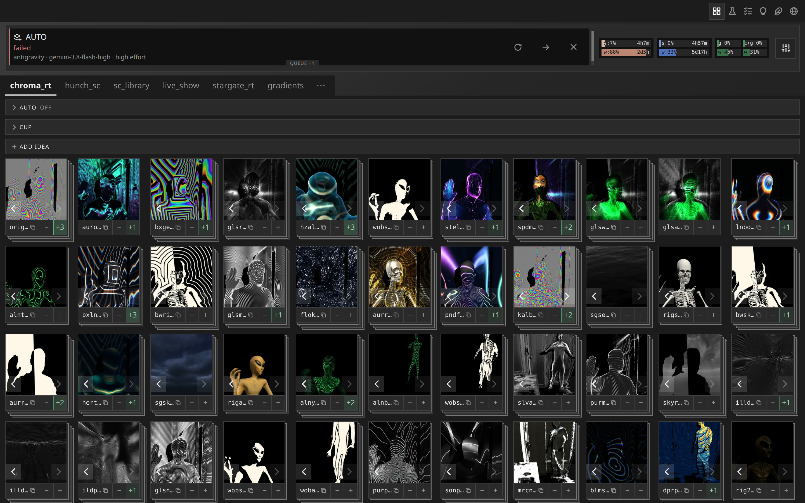
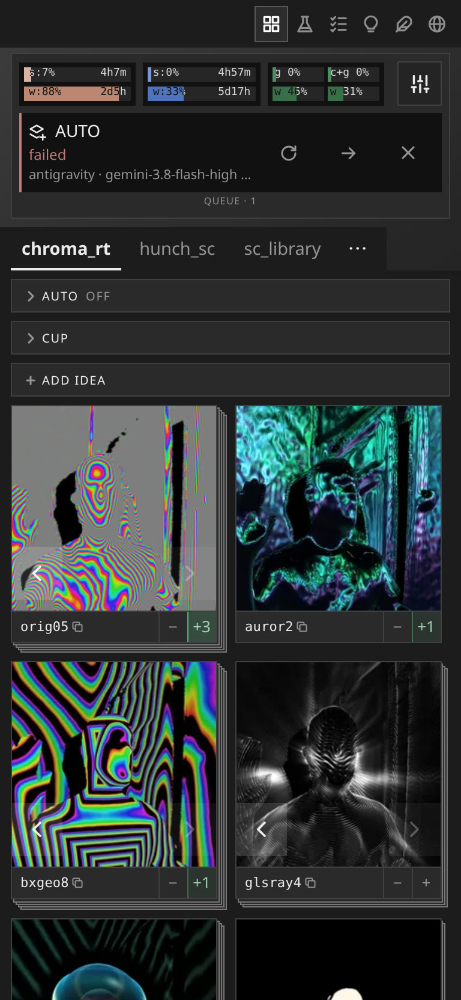
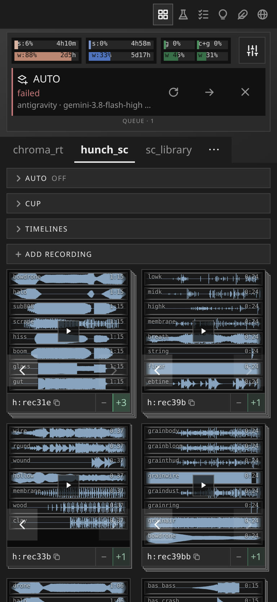
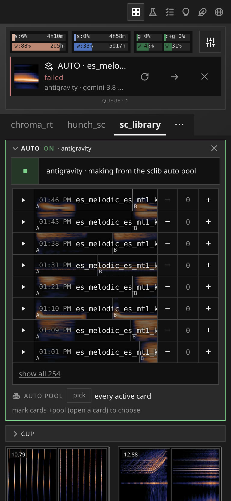

# picker

Asking agents for work in a chat is slow, because every request is typed; judging what comes back is fast. The picker
is a web page where agents' work arrives as cards (a picture, a video, a sound) and you judge it: vote, write what
should change, and send a card back for a new version or a new idea. AUTO can do the asking for you, from the cards
you put in its pool. Each tab is one of three kinds: *picked*, where you judge every card and your votes steer the next;
*hybrid*, where a score orders the cards and you decide where it can't; and *scored*, where a score keeps or drops each
try and you read the trail, best first. A project adds its own tab with a manifest, a runner and a sync
(`docs/TYPES.md`).

Agents run locally through Claude Code, ChatGPT/Codex and Antigravity, logged in with their **subscriptions only**:
API keys and pay-per-use accounts are unsupported, since unattended work bills per token and the usage bars/session
caps read only subscription windows. Keep API keys out of the environment; known provider keys and cloud-backend
selectors are removed from agent and check processes.
They are restricted by default. Set `unrestricted_agents = true` at the top level of `picker.toml` to disable
Codex and Antigravity's approval/sandbox restrictions, as agents that render or talk to local services may need.
Without that opt-in, an agent with no verified restricted unattended mode cannot start; settings says why.
The picker has no login, so keep it on localhost or a private network.

## Installation

You need git, [uv](https://docs.astral.sh/uv/) (it fetches Python and the server's few packages) and, for sound tabs,
ffmpeg. Then:

    git clone https://github.com/tomana/picker
    cd picker
    uv run server.py --config examples/picker.toml

and open http://127.0.0.1:8080. That runs two example tabs with a fake agent that needs no model or account
(`examples/README.md`). For your own projects, write a `picker.toml` like `examples/picker.toml` that lists your tabs,
and start the server with it. For real agents, install their command-line tools and log in to them (`claude`, `codex`,
`agy`) with their subscription accounts; the picker uses those logins and holds no keys of its own.

Settings also offers a per-agent **session cap**: off (100%), or 50-90%. It holds new jobs at that fraction of the
agent's account session, never stops a running job, and holds new jobs if capped usage is unknown. Off performs no
usage reads for admission. Capped polling shares the usage bars' CLI readers, adapts to observed consumption in
30-second to 10-minute intervals, and is idle without running or waiting work; it is an admission guard, not a hard
spending ceiling for a job already running.

**On your phone.** With [Tailscale](https://tailscale.com) on the computer and the phone, `tailscale serve --bg 8080`
puts the picker at `https://<computer>.<tailnet>.ts.net`, for your own devices only; add that name to
`[server] names` in your `picker.toml`, since the picker answers only to the names it knows. Turn on HTTPS certificates in
Tailscale's admin console the first time. Don't use `tailscale funnel`: that puts it on the open internet, with no login.

**No guarantees.** This software is provided as is, without warranty, as described in [LICENSE](LICENSE).
Session caps, restricted mode and API-key filtering are best-effort safeguards, not guarantees; check your
providers' usage yourself. You are responsible for what your agents do and cost, and for following each provider's
terms of service. This project is not affiliated with or endorsed by Anthropic, OpenAI or Google; their product
names belong to their respective owners.
